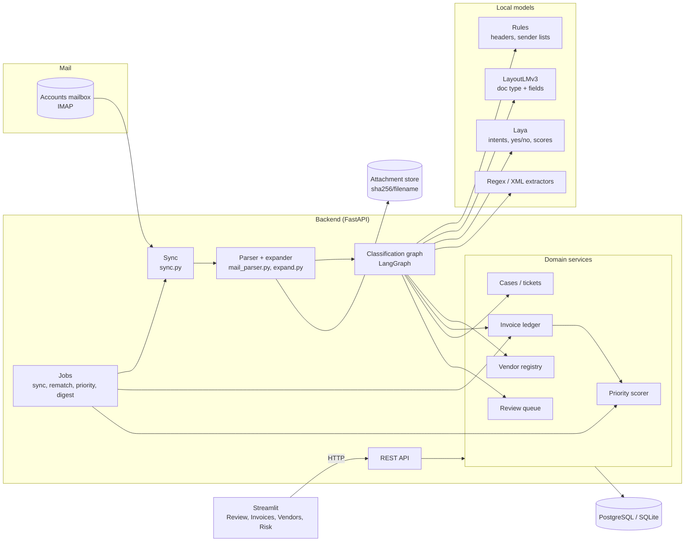
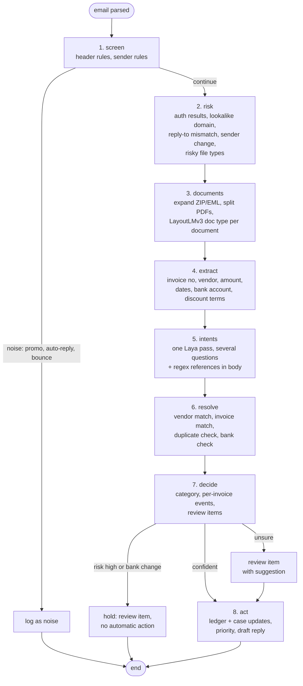
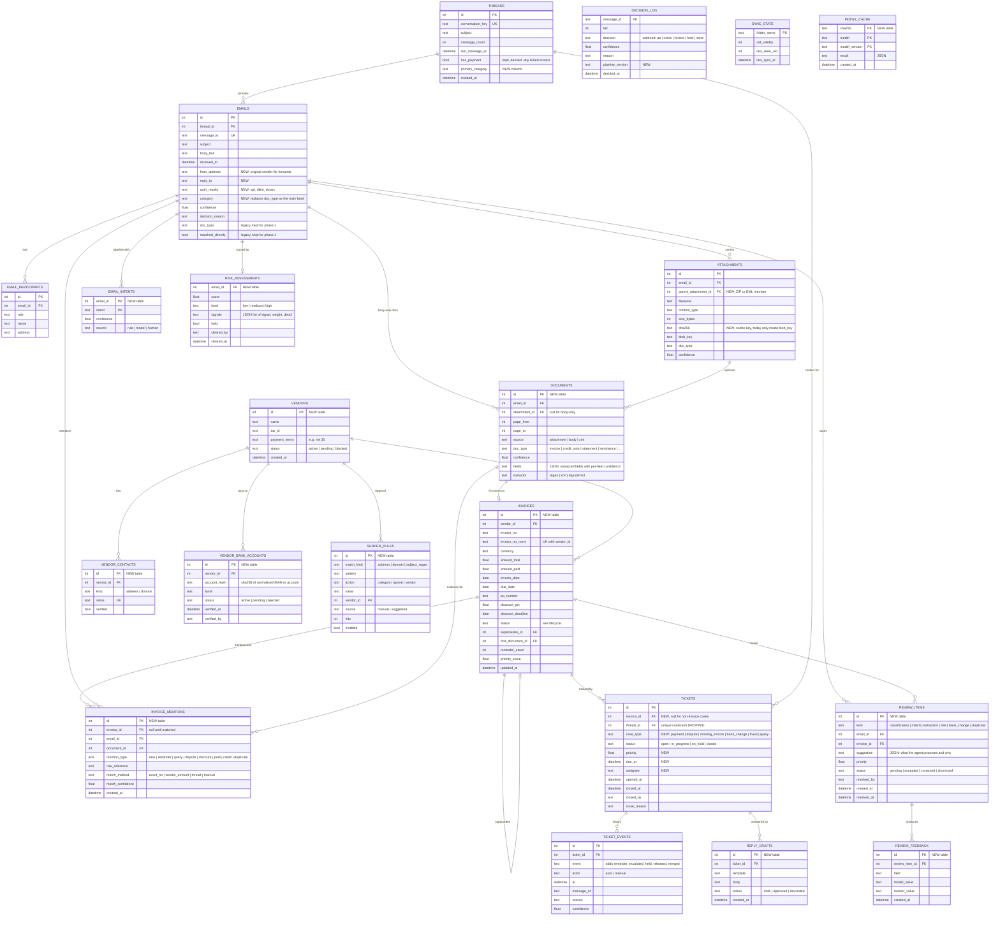
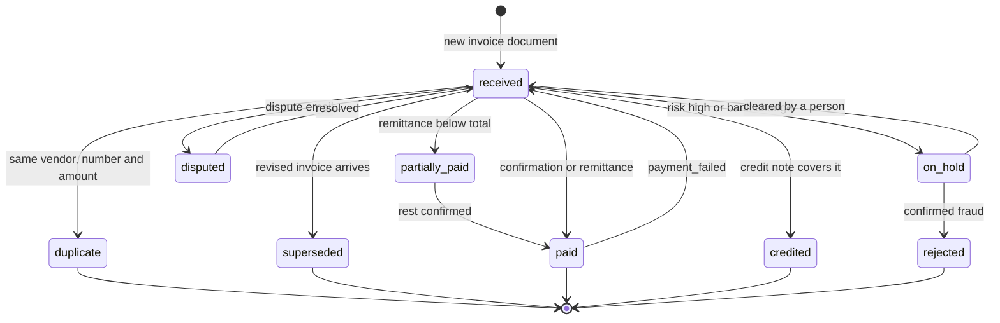

# Accounts Payable Mailbox Agent: Design

Status: proposal, 2026-10-21. Nothing here is built yet. It extends the live
Mailbox Viewer (Task 1); the current design is in `backend/SCHEMA.md` and
`CODE_GUIDE.md`.

Scope: **one accounts department mailbox.** The goal is to classify every
email that arrives, track every invoice it mentions, catch fraud before any
automatic action, and leave a person only the decisions the machine cannot
make with confidence.

---

## 1. Why the current model has to change

Today the unit of work is the **email** and the **thread**: one decision per
email (`payment | review | none`), one ticket per thread (`tickets.thread_id`
is unique). Accounts payable works per **invoice**, and an invoice is not
tied to one email or one thread.

| Situation | Today | Root cause |
|---|---|---|
| Reminder about an earlier invoice in a **new** thread | May open a second ticket for the same invoice, or be dropped | No invoice identity, so nothing to match against |
| One email with 3 invoices | One ticket; one confirmation closes all three | Ticket is per thread, not per invoice |
| New invoice + "please pay the old one" | Both mixed into one ticket that never auto-closes | One label per email; no intents |
| Phishing reply in an existing payment thread | **Inherits "payment"** by the thread rule | No risk check; inheritance is unconditional |
| Promo mail with a PDF brochure | Runs LayoutLMv3 and Laya, ends as `none` | No cheap rules before the models |
| Early-payment discount offer | Labelled `quotation` or `invoice`; deadline lost | No label, no field extraction |
| Invoice inside a ZIP, XML e-invoice, forwarded `.eml` | Stored, but never read | The model reads only PDF/PNG/JPEG/DOCX; the sender and body of an attached `.eml` are lost |

The design below keeps everything that works (IMAP sync, de-duplication,
threading, the attachment store, LangGraph, the two local models, the audit
trail) and adds an **invoice ledger** and a **review queue** on top.

---

## 2. Architecture



Principles kept from today:

- Frontend talks only to the API.
- Models run locally; no network calls during classification.
- Every decision is logged with its reason; every status change is an event.
- One bad email never stops a sync.

New principles:

- **Invoice is the unit of work.** Emails are evidence attached to invoices.
- **Risk first.** The risk check runs before anything can act, and a high
  risk score switches off inheritance and automation for that email.
- **Cheap before expensive.** Header rules, then a hash cache, then models.
- **Human in the loop by exception.** Low confidence, conflicts, risk and
  every bank-detail change become review items with a pre-filled suggestion.
- **Corrections are data.** Every human correction is stored and feeds
  rules, thresholds and retraining.

---

## 3. Classification pipeline (per email)

Replaces the two-node graph in `classification_graph.py`.



### 3.1 Screen (no model)

| Signal | Result |
|---|---|
| `List-Unsubscribe`, `Precedence: bulk`, known marketing senders | `noise / promotion` |
| `Auto-Submitted: auto-replied`, out-of-office subject patterns | `noise / auto_reply` |
| `mailer-daemon`, `postmaster`, DSN content type | `noise / bounce`; marks the original thread |
| Matching row in `sender_rules` | Category or vendor from the rule |

A **discount offer from a known vendor** is never screened out as promotion:
known vendor domains skip the promo rule and go on to the models.

### 3.2 Risk

Signals are added up into a 0..1 score; each signal is stored, so the reason
is visible in the UI.

- SPF, DKIM or DMARC `fail` in `Authentication-Results`
- `Reply-To` domain differs from `From` domain
- Lookalike of a known vendor domain (edit distance, homoglyphs: `acme-c0rp.com`)
- Sender domain changes partway through a thread
- First-time sender asking for payment, or urgency language
- Bank details in the email or invoice differ from `vendor_bank_accounts`
- Risky attachments: `.html`, `.htm`, `.js`, `.exe`, `.iso`, macro-enabled Office files

`risk.level = high` → hold, no inheritance, no automatic action.
A bank-detail change is **always** held, whatever the score.

### 3.3 Documents and extraction

- **Expand containers** before classification: ZIP members, attached `.eml`
  messages, and XML e-invoices (UBL / PEPPOL / country formats are parsed
  directly, no model needed).
- **Split multi-invoice PDFs**: classify each page; consecutive pages with
  the same invoice number form one document.
- **LayoutLMv3**: move from `invoice | not_invoice` to
  `invoice | credit_note | statement | remittance | purchase_order | proforma | receipt | other`.
  This needs retraining with labelled samples.
- **Fields**: phase 1 uses `pdfplumber` text + regex (invoice no, amounts,
  currency, dates, IBAN/account, "2/10 net 30"). Phase 4 fine-tunes
  LayoutLMv3 for field extraction (token classification).
- **Body-only invoices** become a `documents` row with `source = body`.

### 3.4 Intents (Laya)

One call to `system_one()` with several questions, instead of today's two
separate calls (`predict` and `confirms_payment`):

| Question id | Type | Options / meaning |
|---|---|---|
| `group` | choice | invoice_documents, follow_up, payment_proof, vendor_admin, internal, other |
| `subtype` | choice | options for the chosen group (asked in a second pass only when needed) |
| `confirms_payment` | yes/no | as today, for closing |
| `needs_reply` | yes/no | drives drafts and the queue |
| `urgency` | score | final notice, legal threat, overdue |
| `mentions_discount` | yes/no | early-payment offer |
| `mentions_bank_change` | yes/no | feeds the risk check |

The two-level `group` / `subtype` split keeps each option list short:
`rl_agent_api` raises an error when options do not fit in `head_max_len`.

Intent taxonomy (an email can have several):

| Group | Intents |
|---|---|
| invoice_documents | new_invoice, revised_invoice, credit_note, proforma, statement_of_account |
| follow_up | reminder, status_query, dispute, final_notice, discount_offer |
| payment_proof | payment_confirmation, remittance_advice, payment_failed |
| vendor_admin | bank_detail_change, vendor_onboarding, tax_document, audit_confirmation |
| internal | approval_request, forwarded_invoice, po_copy |
| noise | promotion, auto_reply, bounce, newsletter |

### 3.5 Resolve (matching)

For every invoice reference (from a document or from the body):

1. Vendor: sender address → `vendor_contacts`, else domain → `vendor_domains`,
   else name on the document. Forwarded mail uses the original sender.
2. Invoice: `(vendor_id, invoice_no_norm)` exact match →
   vendor + amount ± 1% within 120 days → same thread → no match.
3. Outcome:
   - **New document, no match** → new invoice.
   - **New document, exact match, same amount** → duplicate (no new case).
   - **New document, match, different amount or "revised"** → new invoice
     that supersedes the old one.
   - **Reminder / query, match** → mention on the existing invoice.
   - **Reminder / query, no match** → `missing_invoice` case
     ("we never received it").
   - **Bank details differ from vendor master** → bank_change hold.

Every link is stored in `invoice_mentions` with the method and a confidence;
weak matches become review items.

### 3.6 Decide and act

- `emails.category` = primary group; `email_intents` = all intents.
- Per invoice: apply the lifecycle (section 5) and write `ticket_events`.
- Recompute `invoices.priority_score`.
- Optional draft reply from a template (status query, duplicate, missing invoice).

**Thread rule, changed:** a reply in an AP thread is still **kept**
(today's backfill behaviour stays), but it no longer **inherits a decision**.
It goes through the pipeline; the thread is only a fallback when matching
finds no invoice number. Inheritance is off whenever risk is high.

---

## 4. ERD

Legend: **existing** tables are kept (with changes listed in section 7);
**new** tables are marked in their header comment.



### Key constraints

- `invoices (vendor_id, invoice_no_norm)` unique: the duplicate guard.
  `invoice_no_norm` = upper case, no spaces, dashes or leading zeros.
- `vendor_contacts.value` unique: one address or domain belongs to one vendor.
- `vendor_bank_accounts` stores a hash and last 4 digits only, never the full number.
- `tickets.thread_id` is no longer unique: one thread can carry several invoices.
- `invoice_mentions.invoice_id` nullable: an unmatched reminder is kept and
  becomes a `missing_invoice` case.
- Cascades follow today's rule: deleting an email removes its participants,
  attachments, intents, risk row and documents; invoices are never deleted by
  cascade (`ON DELETE RESTRICT` from mentions and documents).

---

## 5. Invoice lifecycle



Reminders and status queries don't change the status. They increase
`reminder_count`, raise the priority and add a `reminder` ticket event.

Priority score (0..100, weights configurable):

```
priority = 30 * due_urgency        (1.0 at or past due, falls to 0 at 30 days out)
         + 20 * discount_at_risk   (1.0 if discount deadline within 3 days)
         + 15 * min(reminders, 3)/3
         + 15 * final_notice
         + 10 * amount_band        (log scale against the vendor's typical amount)
         + 10 * risk_score
```

Value of an early-payment discount, shown next to the deadline:
`annualised = d / (1 - d) * 365 / (net_days - discount_days)`.
For 2/10 net 30: `0.02 / 0.98 * 365 / 20 ≈ 37%`.

---

## 6. The cases, walked through

| Case | Screen | Risk | Documents / intents | Resolve | Result |
|---|---|---|---|---|---|
| Greeting + reminder on earlier invoice | pass | low | no doc; `reminder` | match by number in body → INV-1042 | Mention on INV-1042, reminder_count +1, priority up, status-reply draft |
| One mail, 3 invoices (one PDF) | pass | low | PDF split into 3 docs; `new_invoice` | 3 new invoices | 3 invoices, 3 payment tickets, closed separately |
| New invoice + "pay the previous one" | pass | low | 1 doc; `new_invoice`, `reminder` | new INV-1100; body reference → INV-1042 | New ticket + escalation on the old one |
| Phishing: "our bank details changed, pay today" | pass | **high**: lookalike domain, reply-to mismatch, bank change | `bank_detail_change`, urgency high | bank account not in vendor master | Hold; review item "verify by phone"; no inheritance, no ticket change |
| Promotion | **noise** (List-Unsubscribe) | not run | not run | not run | Logged as noise; no model cost |
| 2% early-payment discount from vendor | pass (known vendor) | low | `discount_offer`; terms "2/10 net 30" | match to open invoice(s) | discount_pct + deadline set, value ≈ 37%, priority up |
| Duplicate resend | pass | low | `new_invoice` | exact match, same amount | Marked duplicate; draft "already received" |
| Revised invoice | pass | low | `revised_invoice` | same number, new amount | New invoice supersedes old; old ticket closed with reason |
| Credit note | pass | low | `credit_note` | linked to referenced invoice | Balance reduced; credited if fully covered |
| Statement of account | pass | low | `statement_of_account`, many lines | each line matched | Review item listing lines with no matching invoice |
| Remittance advice / confirmation | pass | low | `payment_confirmation` | matched invoices | Paid / partially paid; tickets closed |
| Dispute / short payment | pass | low | `dispute` | matched | Disputed; dispute case opened |
| Final notice / collections | pass | low | `final_notice`, urgency high | matched | Top of queue |
| Forwarded invoice from a colleague | pass | low (uses original sender) | `forwarded_invoice` + doc | vendor from original sender | As a new invoice |
| Out-of-office / bounce | **noise** | not run | not run | bounce marks original thread | Logged as noise |
| Invoice in ZIP or XML | pass | low | expanded / parsed | as usual | As a new invoice |

---

## 7. What changes in the current code

### 7.1 Data layer

| File | Change |
|---|---|
| `mailbox_viewer/models.py` | Add 13 tables: `email_intents`, `risk_assessments`, `documents`, `vendors`, `vendor_contacts`, `vendor_bank_accounts`, `invoices`, `invoice_mentions`, `review_items`, `review_feedback`, `sender_rules`, `reply_drafts`, `model_cache`. New columns on `threads`, `emails`, `attachments`, `tickets`, `decision_log` (see ERD). Drop `unique=True` on `Ticket.thread_id`. Widen `CheckConstraint`s for ticket status/events and decisions. Keep `doc_type`, `matched_directly`, `has_payment` until phase 3 so the current UI keeps working. |
| `create_schema.py` | Keep for fresh installs. **Add Alembic** for upgrades: live databases already have data, and `create_all` does not alter existing tables. |
| `mailbox_viewer/repository.py` | `insert_email` also writes intents, risk, documents and mentions. New queries for invoices, vendors, review items and rules. `_recompute_thread_flags` derives `has_payment` from linked invoices. `reclassify_all` / `redecide_all` replay through the new graph. New counts for the Overview page. |
| `backend/SCHEMA.md` | Replace with the new ERD and ownership notes. |

### 7.2 Ingestion

| File | Change |
|---|---|
| `mailbox_viewer/mail_parser.py` | `ParsedEmail` gains `reply_to`, `auth_results`, `list_unsubscribe`, `auto_submitted`, `original_sender` (from forwarded blocks). Attached `.eml` messages are kept whole (today `walk()` descends into them, keeping their files but losing their sender and body). `sha256` is already computed per attachment; it is now also saved as a column. |
| `mailbox_viewer/expand.py` (**new**) | Opens ZIP and attached `.eml`, returns child attachments with `parent` set; size and depth limits against ZIP bombs. |
| `mailbox_viewer/attachment_store.py` | No change in format; children are stored like any other attachment. |

### 7.3 Classification

| File | Change |
|---|---|
| `mailbox_viewer/classification_graph.py` | Rebuild the graph with the 8 nodes in section 3 and conditional edges (noise exit, hold exit, review branch). `EmailClassifier.classify()` keeps its signature but returns the richer `Decision`. `inherit()` is removed; the sync calls `classify()` with a `thread_context` instead. |
| `mailbox_viewer/classifier.py` | `BODY_LABELS` → the intent taxonomy (two levels). `PAYMENT_LABELS` → AP intents. `Decision` gains `category`, `intents`, `documents`, `risk`, `references`. `combine()` stays as the confidence rule for the document type. `inherited_decision()` removed. |
| `mailbox_viewer/document_model.py` | `LayaBodyModel.analyze(subject, body, questions)`: **one** `system_one()` call for all questions, body cleaned once. `predict()` and `confirms_payment()` become thin wrappers during the migration. LayoutLMv3 wrapper accepts the multi-class v3 model and a page index. Results cached in `model_cache` by sha256 + model version. |
| `mailbox_viewer/screening.py` (**new**) | Header rules and `sender_rules` lookup. |
| `mailbox_viewer/risk.py` (**new**) | Risk signals, score and level. |
| `mailbox_viewer/extraction.py` (**new**) | Regex extractors (invoice no, amounts, currency, dates, IBAN/account, discount terms), UBL/XML parser, PDF page splitter. |

### 7.4 Domain services

| File | Change |
|---|---|
| `mailbox_viewer/vendors.py` (**new**) | Vendor lookup by address/domain/name, lookalike check, bank account check, CSV import of a vendor master. |
| `mailbox_viewer/invoices.py` (**new**) | Matching (section 3.5), lifecycle (section 5), duplicate and supersede rules. |
| `mailbox_viewer/tickets.py` | `MailFacts` → `InvoiceEvent` (invoice id, event, message id, confidence). `apply()` works per invoice, so one confirmation closes only the invoices it names. New `case_type`s and `on_hold`. `rebuild()` replays from `invoice_mentions`. Aging buckets stay. |
| `mailbox_viewer/review.py` (**new**) | Create review items with suggestions; accept / correct / dismiss; write `review_feedback`; suggest `sender_rules` after repeated identical corrections. |
| `mailbox_viewer/priority.py` (**new**) | Priority formula and discount value. |
| `mailbox_viewer/drafts.py` (**new**) | Template replies (status, duplicate, missing invoice). Drafts only; nothing is sent automatically. |

### 7.5 Sync

`mailbox_viewer/sync.py`, `_Processor._judge_and_store`:

- Step 3 still finds the thread, but passes `thread_context` (is AP thread,
  linked invoices, earlier sender domains) to the classifier instead of
  choosing `inherit()` vs `classify()`.
- Step 4 runs the full graph for every email (cheap for noise thanks to the
  screen node, and the attachment cache skips repeats).
- Step 5 keep policy: `store_only_payment` → `keep_policy = ap_only | everything`.
  Keep = category is not noise, or the email is in an AP thread, or it has a
  review item or a risk hold.
- The separate `payment_confirmation()` call disappears (it is one of the
  Laya questions).
- `_update_ticket` → `invoices.apply(...)` then `tickets.apply(...)` per invoice event.
- `_backfill_ancestors` is unchanged; it now triggers when an email becomes AP-relevant.

### 7.6 Settings (`mailbox_viewer/config.py`, `.env.example`)

New: `KEEP_POLICY`, `OWN_DOMAINS`, `RISK_HOLD_THRESHOLD` (0.6),
`MATCH_AMOUNT_TOLERANCE` (0.01), `MATCH_WINDOW_DAYS` (120),
`DISCOUNT_ALERT_DAYS` (3), `PRIORITY_WEIGHTS`, `VENDOR_MASTER_CSV`,
`PIPELINE_VERSION`. `PROFILE_NAME` default becomes `accounts_payable`.

### 7.7 API (`api/main.py`, `api/schemas.py`, `api/jobs.py`)

| Endpoint | Purpose |
|---|---|
| `GET /invoices`, `GET /invoices/{id}` | Ledger with filters (status, vendor, due, priority) and mention history |
| `GET /vendors`, `POST /vendors/import`, `PATCH /vendors/{id}` | Vendor master |
| `GET /review`, `POST /review/{id}/accept`, `POST /review/{id}/correct`, `POST /review/{id}/dismiss`, `POST /review/bulk` | Review queue |
| `GET /risk/holds`, `POST /risk/{email_id}/clear`, `POST /risk/{email_id}/confirm_fraud` | Risk holds |
| `GET /rules`, `POST /rules`, `POST /rules/{id}/enable` | Sender rules, including suggested ones |
| `GET /tickets/{id}/drafts`, `POST /drafts/{id}/approve` | Reply drafts |
| `GET /digest` | Today's summary: new invoices, overdue, discounts closing, holds |
| Jobs: `POST /jobs/rematch`, `POST /jobs/priority` | Re-run matching after a vendor import; nightly priority refresh |

Existing endpoints keep working. `/tickets` gains `case_type` and
`invoice_id` filters. `/profiles` reports the new settings.

### 7.8 Frontend (`frontend/`)

| File | Change |
|---|---|
| `views/review.py` (**new**) | Ranked queue; each item shows the suggestion, reason, extracted fields and thread summary; Accept / Change / Dismiss; bulk accept for grouped items. |
| `views/invoices.py` (**new**) | Ledger, per-invoice timeline (every mention and event), discount deadlines. |
| `views/vendors.py` (**new**) | Vendor master, contacts, bank accounts (last 4 only), CSV import. |
| `views/risk.py` (**new**) | Held emails with signals; clear or confirm fraud. |
| `views/inbox.py` | Category and intent labels, risk badge, links to invoices. |
| `views/tickets.py` | Per-invoice tickets, case type filter, priority sort. |
| `views/overview.py` | Counts by category, open amount, overdue, discounts closing, holds. |
| `views/how_it_decides.py` | Renders the new graph (it already uses `mermaid()`). |
| `api_client.py`, `app.py` | New calls and navigation entries. |

### 7.9 Tests

- New unit tests per new module (screening, risk, extraction, matching,
  lifecycle, priority, review).
- One end-to-end test per row of section 6, using `tests/fakes.py` mailboxes.
- Tests that change: `test_tickets.py` (one ticket per thread assumption),
  `test_sync.py` (inheritance), `test_classifier.py` (labels),
  `test_api.py` (new fields).

---

## 8. Delivery phases

| Phase | Contents | Current behaviour |
|---|---|---|
| **1. Safety and speed** | Parser headers, screen node, risk node, one-pass Laya, `model_cache`, inheritance off when risk is high, Alembic | Unchanged except holds and noise |
| **2. Invoice ledger** | Vendors, documents, regex/XML extraction, invoices, mentions, matching, per-invoice tickets | Tickets move from thread to invoice; old tickets migrated |
| **3. Review agent** | Review items, feedback, suggested rules, priority, Review / Invoices / Vendors / Risk pages, drafts, digest | Legacy columns removed |
| **4. Model upgrades** | LayoutLMv3 multi-class + field extraction, PDF splitting by model, Laya fine-tune from feedback, threshold tuning per intent | Higher automation rate |

Migration of existing data (phase 2): for each current ticket, create an
invoice from the stored attachment (regex extraction), link the ticket to it,
and replay `ticket_events`. Threads with no extractable invoice number get an
invoice with `invoice_no = THREAD-<id>` and a review item.

---

## 9. Open questions

1. Is there an ERP or vendor master we can read (CSV export or API)? It makes
   matching, bank checks and "already paid" answers much more reliable.
2. Should drafts ever be sent automatically (e.g. duplicate acknowledgements),
   or always approved by a person?
3. Is a hosted LLM allowed for review-queue items only, or must everything
   stay local?
4. Which currencies and e-invoice formats does the mailbox receive?
