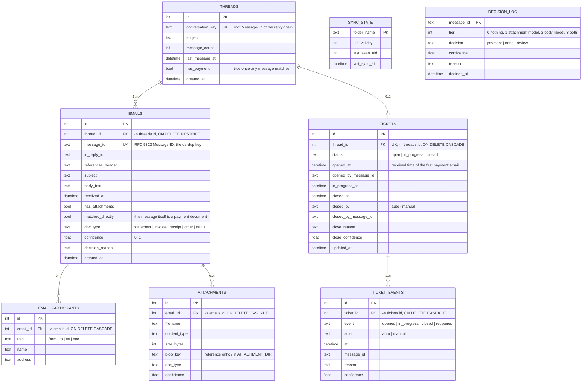

# Cache schema

Status: the six-table model below was adopted on 2026-09-30 from a design
sketch and is the live schema (`mailbox_viewer/models.py`). It replaced the
original three-table design, whose history is at the end of this file. Two
tables for aging tickets (`tickets`, `ticket_events`) were added on 2026-10-14.

Database: SQLite or PostgreSQL via SQLAlchemy 2.x ORM, selected by
`DATABASE_URL`. The same models produce `DATETIME` on SQLite and `TIMESTAMP`
on PostgreSQL. `python create_schema.py --ddl postgresql|sqlite` prints the
DDL; the **Data model** page in the app renders it live.

## ERD

## Ownership

- **threads**: one row per conversation, keyed by the root Message-ID
  (first entry of `References`, else `In-Reply-To`, else the message's own
  id). A reply whose root is not cached joins the nearest cached ancestor.
  `message_count`, `last_message_at` and `has_payment` are rolled up on
  insert and recomputed by `--reclassify`.
- **emails**: one row per message. `message_id` UNIQUE is the de-dup
  guarantee; a missing header is replaced by `generated-<sha256 of raw>`.
- **email_participants**: one row per person per role, so To and Cc lists
  that change across a thread stay clean and are searchable.
- **attachments**: metadata tied to the message it arrived on. `blob_key` is
  a reference into the file store; no bytes in the database.
- **sync_state**: the bookmark, one row per folder (`IMAP_FOLDERS`). The next run asks IMAP for
  `UID last_seen_uid+1:*`. A changed `uid_validity` triggers a re-walk, and
  de-dup makes that safe.
- **decision_log**: the audit trail, one row per message, rewritten each time
  the rules run.
- **tickets**: one per payment thread (`thread_id` UNIQUE). Written by the
  sync in the same transaction as the email that changes it; closed or
  reopened by hand from the UI; recreated by **Rebuild tickets**.
- **ticket_events**: every status change, with time, actor and reason.

## How data moves on one refresh

The bookmark is read first and moved last.

| Step | Action | Reads | Writes |
|---|---|---|---|
| 1 | Refresh clicked | `sync_state` | |
| 2 | Fetch UIDs above `last_seen_uid` over IMAP | | |
| 3 | **Already judged?** If `decision_log` has the Message-ID, skip. A rescan never re-judges. | `decision_log`, `emails` | |
| 4 | **Find the thread.** A reply into a thread with `has_payment` is kept regardless of its own content. | `threads`, `emails` | |
| 5 | **Classify** with both models (LangGraph: Laya on the body, LayoutLMv3 on attachments, then the decision rule) | | `decision_log` |
| 6 | **Keep?** Payment document, or payment thread, or `STORE_ONLY_PAYMENT=false` (the default) → save. Otherwise drop: only the log line is written. | | |
| 7 | **Save in one transaction**: thread (found or created), email, participants, attachments, and the thread's ticket (open, in progress, close, reopen). Files were written to the store just before. When a thread turns into a payment thread, its earlier mail that was dropped is backfilled from the mailbox by Message-ID. | `tickets` | `threads`, `emails`, `email_participants`, `attachments`, `tickets`, `ticket_events`, files |
| 8 | Move the bookmark | | `sync_state` |

Streamlit reads `threads`, `emails`, `email_participants`, `attachments` and
`decision_log`. Never the mailbox.

## Classification

Two local models, run as a LangGraph flow (`classification_graph.py`).
LayoutLMv3 (trained) labels each PDF, image or DOCX attachment invoice /
not_invoice first; above 0.8 (`ATTACHMENT_DECIDES_CONFIDENCE`) it decides the
email on its own and Laya is skipped. Otherwise Laya (zero-shot) reads the
body and counts as payment at 0.7 or more (`BODY_MIN_CONFIDENCE`), with 0.5
to 0.7, or a weak invoice call Laya does not support, going to `review`.
Without a readable attachment Laya decides alone. Once an email of a thread
is payment, later emails of that thread inherit it without running Laya;
LayoutLMv3 still labels their attachments (`matched_directly` false, reason "part of a thread already classified
as payment"). Re-classify and re-decide replay emails oldest first so the
thread rule sees earlier emails first. See the README table.

`decision_log.decision` allows `payment`, `none` and `review` (the `review`
value was added on 2026-10-07; `init_db` upgrades the PostgreSQL check
constraint in place). `tier`: 0 nothing classified, 1 attachment model only,
2 body model only, 3 both. The reason always starts with the body model's
label and score (`body: receipt (0.75) ...`), which is what lets `--redecide`
re-apply a changed rule without running the models again.

## Tickets

One aging ticket per payment thread (`tickets.py`):

| Event | Rule |
|---|---|
| **Open** | The first email of a thread judged payment on its own content. Age counts from its received time. |
| **In progress** | We reply in the thread: an email sent from `IMAP_USER`. |
| **Closed** | A later reply that Laya scores at least `TICKET_CLOSE_CONFIDENCE` (0.8) on "does this email confirm that a payment has been made or received?". Asked only while a ticket is active. |
| **Never closes** | An email that carries a new invoice. Checked on 2026-10-14: a plain invoice scored 0.75 on the question, too close to the bar. |
| **Reopened** | A new invoice arriving in a closed thread. |
| **Manual** | Close or reopen from the Tickets page, with an optional reason (`actor = manual`). |

Age: open and in-progress tickets age until now, closed ones stop at the close.
Buckets: 0–2, 3–7 and 8+ days.

## Attachments

Bytes live under `ATTACHMENT_DIR/<sha256>/<filename>` (default
`data/attachments/`). Content-addressed keys mean identical files are stored
once and retries are idempotent. Files are written between database
transactions, so the database write lock is never held during disk I/O. The
store refuses any key that could escape its root.

## History

- 2026-09-25: original three tables (`emails`, `attachments` with inline
  BLOBs, `sync_state`) plus an eight-way category label. Reviewed and built.
- 2026-09-25: Azure Blob Storage tried via the Azurite emulator; removed the
  same week after its default telemetry raised an endpoint-security alert.
- 2026-09-30: six-table model adopted; attachments moved to the local file
  system; categories dropped in favour of `doc_type` / tier / decision log.
- 2026-10-06: keyword rules removed; classification comes only from the
  trained document model. The app split into a backend API (FastAPI) and a
  Streamlit frontend that talks to it over HTTP.
- 2026-10-07: classification by two local models through LangGraph: Laya on
  the body (zero-shot), LayoutLMv3 on attachments (trained). `review` added
  as a decision. Laya counts as payment only at 0.9 or more.
- 2026-10-07: payment bar for Laya lowered from 0.9 to 0.7 at the user's request.
- 2026-10-07: rule set by the user: attachment model decides alone above
  0.8, otherwise Laya is consulted (0.7 bar); without attachments Laya
  decides; later emails of a payment thread inherit payment.
- 2026-10-07: inherited emails get their attachments labelled by LayoutLMv3.
  Storage switched to payment-related mail only (`STORE_ONLY_PAYMENT=true`);
  review emails are kept so they can be checked.
- 2026-10-12: inline images of 20 KB or more count as attachments, so invoice
  photos added from a phone (inline, with a Content-ID) reach LayoutLMv3.
- 2026-10-14: aging tickets: `tickets` and `ticket_events` added, opened and
  closed by the mail itself (Laya confirmation at 0.8) or by hand.
